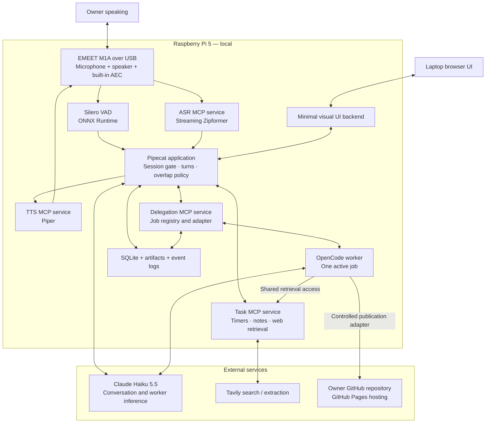
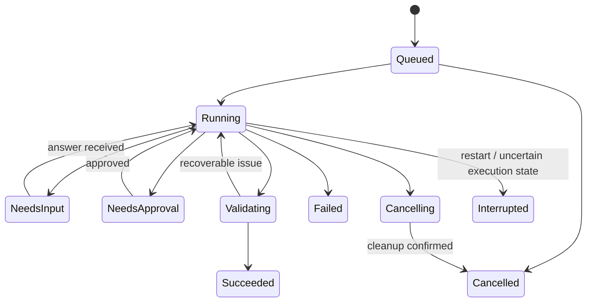

# ME3 Full-Duplex Voice Agent

## Architecture and development plan — v1.0

Prepared for Ken • 8 November 2026 • Target: Raspberry Pi 5, 8 GB

This document consolidates the agreed design. Selected components are not yet validated together. Numeric timings are initial tuning settings or engineering targets, not measured results. Final-demo planning and detailed execution permissions are deferred. No software installation, account configuration, or hardware validation is claimed by this plan.

## 1. Goal and boundaries

Build an English-first, conversational, interruptible voice agent whose runtime, pretrained speech inference, VAD, MCP servers, state, and task execution run on the Pi. Only LLM inference and task-specific external services run remotely. No model training is required. Lightweight pretrained models are allowed under the clarified assignment requirements.

The agent must perform direct tools and investigate unfamiliar requests through a background harness. It should try reasonable alternative approaches within time/cost limits, ask only for information or authorization it cannot resolve, and promptly explain definitive blockers. Conversation remains available while delegated work runs.

Initial capabilities: timers, notes, web search and page extraction, small website creation, and publication to the owner's configured GitHub repository and GitHub Pages site. To-dos follow timers/notes. Public profile information is explicitly approved; the system does not identify the speaker biometrically.

## 2. Target architecture

Arrows describe logical dependencies, not the final socket layout. Live PCM uses local WebSockets; MCP control uses stdio. The application coordinates device audio, speech sessions, and output queues. AEC is performed by the M1A initially. Its Linux compatibility and double-talk performance remain acceptance gates.

| Boundary | Local | Remote |
|---|---|---|
| Speech | M1A, audio buffers/resampling, Silero, Zipformer, Piper | None in initial design |
| Reasoning | Prompts, context construction, tool dispatch | Haiku inference |
| Execution | OpenCode, workspaces, files, validation commands | Task APIs and publication destinations |
| Memory | SQLite and job/session records | Selected context sent to LLM |
| Web | Request orchestration and extraction normalization | Tavily and retrieved websites |
| UI | Backend and static assets hosted on Pi | Laptop is a display/control client on the LAN |

Raw live microphone audio is not sent to cloud speech services. Transcripts, selected context, search queries, website requests, and publication content leave the Pi as needed. Benchmark recordings are a separate evaluation artifact.

## 3. Decision register: rationale, tradeoffs, and validation

| # | Agreed choice | Expected benefit | Limitation / development consequence | Validation or revisit trigger |
|---|---|---|---|---|
| 1 | Local pretrained speech; cloud LLM | Avoid speech API dependency and usage fees | Local CPU contention; cloud reasoning still required | Concurrent speech pipeline test |
| 2 | sherpa-onnx streaming English Zipformer, 2023-02-21, documented INT8 encoder/joiner + decoder | Incremental recognition; replaceable engine | Older checkpoint; accent, names, numbers unverified | WER, critical arguments, partial/final delays; compare Whisper if inadequate |
| 3 | English first | Reduces language scope | No claim of reliable Taglish support | Natural accent and local-name tests |
| 4 | Piper, provisional en_US-lessac-medium | Local neural speech; manageable selected model | Sentence latency, pronunciation and prosody | First audio, listening quality, ASR contention; Kokoro deferred |
| 5 | Purchased EMEET M1A for both input/output | Integrated wired audio and advertised full duplex/AEC | Manufacturer's M1A OS list does not establish Pi support | Detect, record/play concurrently, reboot, overlap tests |
| 6 | M1A AEC first; no added software AEC | Less Pi work and integration | Residual echo or suppressed quiet speech | Add/change processing only on measured failures |
| 7 | Local Silero ONNX VAD | Speech activity signal; existing integration path | Cannot identify owner or intent | Quiet speech, noise, echo and onset latency |
| 8 | UI session toggle | Natural conversation after one activation | Active-session background speech can interfere | OFF cancels conversational output and input forwarding |
| 9 | Pipecat, initial 1.15.0 pin | Voice orchestration, MCP, frames/events | Custom adapters and version compatibility | Integration suite; avoid untested alpha features |
| 10 | Direct Claude Haiku 5.5 API | Low-cost candidate for conversation/tool routing | Provider delay, quotas, tool mistakes | Correctness, p95, cancellations, usage |
| 11 | Adaptive silence + transcript heuristics | Accommodates hesitation without extra cloud classifier | Heuristic errors; interacting endpoint timers | Pause/correction bank; fixed timeout baseline |
| 12 | Pause overlap, classify locally, resume or yield | Prompt silence without discarding every backchannel | Resume state, bounded buffering, classification errors | False cancellations, missed steering, resume quality |
| 13 | Event-driven acknowledgments; sparse switchable backchannels | Truthful feedback with controlled frequency | Repetition, tone mismatch and wasted overlap | Annoyance, timing and substantive response separately |
| 14 | Four MCP services | Clear responsibilities and failure boundaries | More lifecycle/transport coordination | Server restart, cancellation, IDs and bounds |
| 15 | Timers and persistent notes; to-dos extension | Observable useful actions | Ambiguity, persistence and duplicate handling | State assertions and timeout/retry tests |
| 16 | OpenCode, Haiku initially, one job | Headless coding worker and replaceable adapter | Builds compete for CPU; generalized success not assured | Website + correction + ongoing conversation |
| 17 | SQLite, bounded history, summaries, selective retrieval | Inspectable local state without vector infrastructure | Summary errors and stale preferences | Compaction recall, revision and recovery tests |
| 18 | Concise friendly task persona | Short natural spoken turns | Prompt alone cannot enforce execution policy | Truthful status, verbosity and confirmation checks |
| 19 | Bounded recovery; no second provider initially | Predictable cost/delay and visible failures | Some work remains unavailable during outages | Fault injection and no duplicate actions |
| 20 | Native systemd, isolated dependencies, separate worker | Direct audio access and restart/resource controls | Service ownership and dependency setup | Cold boot, child cleanup, install reproduction |
| 21 | Colleague benchmark + supplementary tests | Shared protocol and comparable reports | Software feed bypasses hardware; adapter compatibility | Pinned commit, instrumentation audit and M1A trials |
| 22 | Demo/deck planning deferred | Focus on implementation now | Actual historical tasks still inform scope | Fill template only from measured behavior |

Additional agreements: Tavily retrieval, owner repository via PAT, minimal visual UI, detailed execution permissions later. Runtime dates/locale must be supplied, not inferred from model knowledge. Pin exact model identifiers and package versions when installation is verified; review earlier candidate versions for availability without silently changing the selected design.

## 4. Service contracts and transport

Four logical MCP services remain the public integration boundary. Protocol tool names below are illustrative until schema validation. Speech controls are called by application code, not advertised as low-level decisions to the conversational LLM.

| Service | Proposed tools | Data plane / outputs |
|---|---|---|
| ASR | session.start, session.stop, transcribe | Local PCM stream; partial/final transcripts with segment IDs |
| TTS | speech.start, speech.cancel | Local audio stream with utterance ID, sequence, sample rate and completion |
| Tasks | timer.create/list/update/cancel; notes.add/search/edit/delete; web.search/fetch/crawl | Structured state or evidence with URLs, dates and errors |
| Delegation | jobs.submit/status/update/cancel/result | Job ID promptly; structured state, progress and artifact references |

Transport baseline: stdio JSON-RPC for MCP control; loopback WebSockets for speech PCM/events. Specify format at session setup, validate length/rate/channels, and use bounded queues with backpressure. Normalize capture to 16 kHz mono for ASR/VAD; do not assume the device's advertised rate is its only ALSA format. Use Piper's actual voice output rate and resample at a defined boundary. Keep logs off protocol stdout.

Lifecycle ownership: systemd owns Pipecat/backend and the independent OpenCode service. Pipecat owns MCP child processes. No process is restarted by two supervisors. Child inference must not block audio callbacks or the application event loop. Rate-limit progress polling.

Important unresolved transport detail: stdio is not a multi-client endpoint. If both Pipecat and OpenCode need Task MCP, expose a second authenticated loopback Streamable HTTP endpoint on the same logical task service, or proxy worker retrieval through delegation. Choose and integration-test one method; do not spawn independent timer/note stores accidentally. This does not require a fifth logical service.

Every request includes request_id and relevant session_id, turn_id, utterance_id or job_id. State-changing operations accept idempotency_key. Errors distinguish retryable, needs_input, needs_approval, unsupported, failed and unknown_outcome. Acknowledged cancellation is not proof that subprocesses have stopped.

## 5. Conversation and audio state machines

```mermaid
stateDiagram-v2
    [*] --> Off
    Off --> Listening: UI ON and ready
    Listening --> Thinking: committed turn
    Thinking --> Speaking: output ready
    Speaking --> OverlapPaused: speech detected
    OverlapPaused --> Speaking: clear backchannel / false trigger
    OverlapPaused --> Listening: steering or unresolved overlap; cancel old reply
    Speaking --> Listening: reply finished
    Thinking --> Listening: user correction; cancel old generation
    Listening --> Off: UI OFF
    Thinking --> Off: UI OFF
    Speaking --> Off: UI OFF
    OverlapPaused --> Off: UI OFF
```

UI OFF stops accepting/forwarding microphone audio, cancels conversational generation, flushes playback, invalidates old utterances and resets transient VAD/ASR state. Implementation should release capture when practical; if a device stream stays open for readiness, discard samples before speech processing and clearly document that behavior. Background jobs/timers continue; spoken notifications wait. Re-enabling must not replay stale speech.

Turn timing starts from the last detected speech audio, not from the end of several stacked timers. Initial normal silence 600 ms; incomplete instruction 1,200 ms; clarification after roughly 2,000 ms of continued silence. Reconcile with ASR endpoint/finalization and cancel pending completion on resumed speech. Do not execute consequential tools from unstable partials.

Overlap: pause/duck promptly on speech activity. Use partial text, duration and dialogue state; do not hard-code all yes/okay as backchannels. Temporary pause retains resumable playback and only a bounded generation buffer. Genuine steering cancels LLM generation, cancels synthesis where supported and rejects late audio. Unresolved overlap yields after a configurable bounded wait. Background task cancellation requires a distinct request.

Preserve continuity when resuming: maintain playback cursor and consumed audio chunks. Track delivered speech approximately by chunk/sentence until word alignment is validated. Store generated, synthesized and played output separately. Never claim exact words heard from generated text alone.

Acknowledgments: one per pending operation, provisional 700 ms delay suppressed when result arrives first. Listener backchannels behind a feature flag, approximately 10-second minimum cooldown and appropriate dialogue opportunity. A cooldown never forces a clip. Cache a few reviewed phrases using the same Piper voice. Avoid expired acknowledgments after task completion, OFF, or cancellation.

## 6. Agent execution policy and background jobs

Directly execute bounded tasks with reliable tools. Delegate unfamiliar or multi-step work. The worker may inspect available tools, documentation, APIs and project files, plan, attempt work, validate, and correct course within configured permissions and budgets. Retry genuinely different approaches when useful; stop immediately for definitive access/billing blockers. Do not bypass approvals or invent capabilities. Ask for the smallest missing decision; prepare concrete reviewable work first where possible.

Persist task specification, chosen harness/model, workspace, instructions/revisions, attempts, timestamps, budget usage, pending user requests, artifacts, checks and final outcome. One active job initially. Updates report applied, queued or restart_required accurately. During cancellation, stop known descendants and reconcile actual processes. Workspace restrictions are not equivalent to an OS sandbox; concrete containment and permission rules must be finalized before enabling general command execution.

Result delivery is scheduled into a suitable gap, with full details in UI. Do not report fabricated percentage progress. Preserve jobs when conversation turns OFF. After restart, reconcile worker state before retries; mark uncertain jobs interrupted rather than completed.

## 7. Web research and GitHub publication

Tavily is the selected search/extraction provider. Begin with bounded basic searches, open relevant sources, and expand queries when evidence is inadequate. Crawl only when linked exploration is needed. Return source URL/title, retrieved time, publication/event dates when known, readable content and extraction errors. Treat web text as evidence, never as authority to change system rules or access credentials. Prefer official election records and credible corroboration; snippets alone are insufficient for definitive current-event answers.

For recent Senate questions, supply date, Asia/Manila timezone and configured Philippine locale. Infer reasonable context but clarify substantive ambiguity: local vote leaders versus nationwide winners are different. Evaluate retrieval accuracy and interpretation without requiring the user to pre-supply every hint. When all bounded paths fail, state uncertainty and the actual blocker.

For personal websites, me resolves to an explicit owner_id and approved public-profile fields, not biometric identity. Research may discover candidates but must not publish guessed or private details. Store public profile separately from private notes.

Publication workflow: generate files in a dedicated workspace; validate content and local rendering; inspect diff; commit/push to the configured repository/branch; trigger or observe configured Pages deployment; verify the resulting public URL and expected content. Push success is not deployment success. Record commit SHA, deployment state and URL. Configure repository type, branch/path or Actions deployment, base path and custom domain if any. Do not expose a preview bound publicly by accident.

PAT remains server-side, injected through a credential mechanism and excluded from prompts, logs, process arguments and git remote URLs. Prefer repo-scoped fine-grained access where supported; exact permissions remain pending. No token should enter the browser UI. An explicit publish request authorizes that configured publication scope; unrelated destructive changes still need separate authorization.

## 8. Memory, UI and data

SQLite owns accepted application facts: sessions/summaries, approved owner profile/preferences, notes, timers, jobs/revisions, artifact metadata and notification state. Use migrations, transactions and appropriate busy handling; test multi-process access. Use monotonic timing for live intervals and stored wall-clock deadlines for restart reconciliation. Back up state and document retention/deletion.

LLM context: stable system/tool prefix, selected owner facts, relevant retrieved notes, summary, recent complete turns and current tool/job facts. Bound by tokens, not arbitrary turn count. Log actual reported tokens when available; label estimates. Summaries must not replace structured state. OpenCode maintains isolated job history; transfer requirements and concise results instead of entire voice/worker transcripts.

Minimal UI implementation default: small TypeScript frontend using Vite and a lightweight component approach, with Python backend HTTP endpoints and WebSocket state events. Serve built assets on Pi. This is a reasonable implementation default, not a user-selected framework commitment. Avoid unnecessary component/chart dependencies.

Views: large ON/OFF toggle; ready/degraded component badges; listening/thinking/speaking status; transcript; timers/notes; job cards with real state and approval/clarification controls; result links/previews; collapsed diagnostics. Typed input/text output support speech-failure recovery. Bind UI to configured LAN interface with an access token or authenticated session; keep MCP/data streams loopback-only. Never expose provider credentials in browser bundles. UI must show OFF on connection loss until backend state is confirmed.

## 9. Failure recovery and observability

One automatic retry initially for eligible transient errors, within a total deadline and provider backoff guidance. Do not retry cancelled work. Invalid keys, exhausted credits and invalid schema requests are not transient. Check operation status/idempotency before repeating writes. Unknown outcome is a valid state.

Use bounded restarts with backoff and visible degraded state. ASR failure permits typed input; TTS failure leaves text results. VAD/audio failure disables voice rather than uncontrolled triggering. Cached local speech may announce LLM unavailability, but new unrestricted offline dialogue is not supported. Active timers and stored state remain available. Worker cloud dependence must be explicit.

Structured logs: monotonic timestamps plus wall-clock correlation; all IDs; stage events; errors/retries; tool and worker durations; model usage; configuration hashes. Redact secrets. Measure CPU/RAM/thermal state and queues. Separate latency to acknowledgment from latency to useful content. Keep instrumentation overhead measurable.

## 10. Development phases and exit gates

Sequence by evidence, not optimistic calendar estimates. Continue UI/state/benchmark development while the M1A is in transit; audio acceptance waits for the device.

Implementation lives under `me3/voice-agent/`. The shared benchmark checkout is `me3/fd-benchmark` at the pinned commit in §11.

### Patch notes

Non-trivial experiments and fixes are logged as patch notes so challenges, changes, and measured outcomes stay auditable:

- Index: `voice-agent/docs/PATCH_NOTES.md`
- One entry per change: `voice-agent/docs/patches/YYYY-MM-DD_short-slug.md` (see `_TEMPLATE.md`)
- Required fields: challenge, change, hypothesis, how measured, before/after, verdict (`improved` | `regressed` | `neutral` | `inconclusive` | `blocked`), follow-up, related decision IDs
- Open an entry when starting meaningful work; close it with evidence before claiming improvement. Reverts get a new entry. Phase exit gates may cite patch IDs.

| Phase | Deliverables | Exit gate |
|---|---|---|
| 0 — Foundation | Repo, configuration schema, dependency lock, decisions, SQLite migrations, service skeletons, patch-notes system | Reproducible environment; pending settings explicit; no secrets in repo; patch index seeded |
| 1 — Local speech feasibility | Zipformer, Piper, Silero persistent services; recorded-input runner | ASR keeps up during TTS; bounded queues; measured CPU/RAM; voice samples reviewed |
| 2 — Device and session | M1A capture/playback, UI toggle, readiness, audio resampling | Concurrent audio and reboot pass; no stale speech after OFF/ON |
| 3 — Conversation | Pipecat + Haiku, adaptive turns, cancellation, backchannels | Pauses/corrections and resume behavior verified on sample bank |
| 4 — Reliable tools | Timer/note tools, idempotency, persistent notifications | State-based correctness; restart and timeout tests |
| 5 — Retrieval and profile | Tavily tools, evidence envelopes, approved owner profile | Fresh question research, citations and ambiguity handling pass |
| 6 — Delegation | OpenCode API adapter, one-job queue, needs-input/approval UI | Voice responsive during task; updates and cleanup verified |
| 7 — Publication | PAT configuration, repo adapter, page validation/deployment | Correct commit and reachable Pages content; no private data leaked |
| 8 — Benchmark integration | Transport injection, observer/explicit marks, trial resets | Pipecat version compatibility; stage semantics audited |
| 9 — Hardening | systemd, resource controls, recovery, soak tests | Reboot/fault matrix and 30-minute sustained run pass |
| 10 — Evidence packaging | Configuration manifest, reports, issue/fix evidence | Claims trace to logs/results; deck preparation deferred until requested |

Do not finalize Pi suitability from RAM alone. Measure realistic concurrent ASR/TTS and a bounded worker task. No acceleration hardware purchase is assumed. If speech deadlines fail, tune threads/chunking/workload, compare a smaller compatible model, or revisit the recorded deployment choice explicitly.

## 11. Benchmark integration and acceptance plan

Primary shared benchmark: https://github.com/trueshotjames/ai231-me3-full-duplex-benchmarking at reviewed commit 57eaddbc188ce9a19b8fd002b575f703426956f4. Local checkout path: `me3/fd-benchmark` (renamed from the upstream repository name to match the benchmark README convention). Keep a pinned checkout; document deliberate updates. Do not replace the class bank with a private 30-scenario suite. Add task/acoustic tests separately.

Run benchmark/scoring on laptop and assistant on Pi. Direct-feed transport bypasses M1A, so compare software and physical-audio runs separately. Keep the same application pipeline after the transport boundary. Use source-transcript WER from our own ASR, not scoring-model transcription as if it were our recognizer output.

Integration checks: adapter says tested on Pipecat 1.13; validate our initial 1.15.0 pin. Standard frames or explicit marks must cover custom speech services. Temporary overlap pauses must appear in recorded output without incorrectly triggering irreversible clear/cancel behavior. Explicitly reset session state, test timers/jobs and temporary notes between independent trials; silence alone is not reset. Use an isolated benchmark database/workspace and never real publication actions in replay without dedicated authorization.

| Measurement | Definition / caution |
|---|---|
| Shared E2E | Preserve repository VAD-end to output definition |
| Audible E2E | Speech-end reference to actual output onset; identify automated versus manual reference |
| Provider TTFT | Request sent to first text token |
| Repository TTFT | ASR-final to first token; includes orchestration, so label separately |
| TTS first audio | Text submission to first playable chunk; framework markers must match reality |
| Overlap pause | Speech onset to silence; distinguish temporary pause from confirmed interruption |
| Task success | Ground truth in timer/note state, artifact checks and deployment URL |
| Resources | Per-process CPU/RAM, temperature, throttle flags, queue and underrun counts |

Internal stages use the Pi monotonic clock. Do not subtract raw laptop/Pi monotonic values. Cross-host alignment is approximate and includes transport effects. Streaming phases overlap; do not sum durations blindly. Report mean/median/p95, sample counts, failures, cold/warm state and benchmark versions. Repository filler-normalized WER should remain comparable; add critical-name/number and backchannel recognition checks. Judge model/version/prompt fixed per comparison; text judges do not establish voice tone quality.

Provisional engineering gates (not course thresholds): p95 overlap pause ≤300 ms; p95 substantive simple-turn response ≤3 s; ≥95% scripted timer/note success and genuine interruption handling; ≤10% unwanted backchannel cancellations; no duplicates in retry tests; 30-minute soak without crashes, growing backlog or thermal throttling. These require adequate sample counts. Record misses and fixes before revising targets. Proposed ASR throughput headroom RTF ≤0.5 under concurrent load is a tuning objective, not a published Pi result.

Supplementary cases: self-correction; 600/1200 ms internal pauses; yes as answer versus backchannel; side talk; echo-only; OFF mid-retry; timer expiry during work; provider timeout; invalid key; disconnect M1A; kill speech process; worker needs input; cancel subprocess tree; restart with uncertain job; GitHub push success/Pages failure; owner profile absent; search insufficient. Only report tested capabilities.

## 12. Risks, budgets and unresolved configuration

| Risk | Mitigation / evidence |
|---|---|
| Pi CPU saturated | Resource-limit worker; tune threads; measure audio under representative work |
| Hardware suppresses overlap | Compare recordings; lower playback volume; revisit AEC/device path |
| Pause classification fails | Context-aware rules and regression bank; yield on uncertainty |
| MCP control conflicts with audio | Separate planes, bounded buffers, session/utterance IDs |
| Framework/version drift | Locked environment and compatibility suite |
| Unbounded autonomous exploration | Time/tool/token/crawl limits; explicit blocked state |
| Search wrong/stale | Date/locale injection, source retrieval and corroboration |
| Incorrect personalization | Owner/public profile records; no guessed identity |
| Publishing only partly succeeds | Separate push/deployment checks and partial outcome reporting |
| Summary or worker state stale | Structured source of truth, timestamps and reconciliation |
| Service outage | Bounded recovery, text UI and no false success |

Budget logging covers Haiku conversation and worker calls independently, Tavily search/extract/crawl credits, and any hosting/external tools. No recurring speech API cost is assumed. Set account alerts and application caps; confirm current pricing at provisioning rather than freezing earlier quoted prices in this plan. A subscription to a chat product must not be assumed to include API usage.

Pending before execution features: repository/account/branch/Pages strategy; PAT permissions/expiry; final owner public biography and links; API credentials; execution boundaries and protected actions; task time/token limits; concrete software versions; UI network access; backup/retention policy; benchmark judge; M1A compatibility; final voice selection. Safe development with test workspaces and mock integrations can proceed before external write permissions are enabled.

## 13. Definition of done

The implementation is ready when reproducible startup, local speech, natural turns/interruptions, accurate timers/notes, source-grounded retrieval, concurrent OpenCode work, approved GitHub publication, persistent state, bounded recovery, and benchmark evidence pass their documented gates. Known limitations remain visible. Final presentation claims derive from the running system and measured results, not this design document.

## References and provenance

This plan records user-approved decisions from this session; it is not a fresh certification of every dependency. Earlier reviewed sources guide implementation and should be checked against pinned releases:

- Pipecat releases: https://github.com/pipecat-ai/pipecat/releases
- sherpa-onnx streaming models: https://k2-fsa.github.io/sherpa/onnx/pretrained_models/online-transducer/zipformer-transducer-models.html
- Piper: https://github.com/OHF-Voice/piper1-gpl — distinguish sentence output from split-model streaming; verify API support in pinned version.
- Silero: https://github.com/snakers4/silero-vad
- EMEET M1A: https://emeet.com/products/speakerphone-m1a
- OpenCode server: https://opencode.ai/docs/server/
- Claude model configuration: https://platform.claude.com/docs/en/models/haiku-5-5/overview
- Tavily: https://www.tavily.com/pricing
- Shared benchmark method: https://github.com/trueshotjames/ai231-me3-full-duplex-benchmarking/blob/57eaddbc188ce9a19b8fd002b575f703426956f4/docs/METHOD.md
- Shared benchmark stage marks: https://github.com/trueshotjames/ai231-me3-full-duplex-benchmarking/blob/57eaddbc188ce9a19b8fd002b575f703426956f4/docs/STAGES.md
- ME3 two-page presentation template supplied by user; final filling deferred.

Alternatives retained in decision history: Whisper.cpp/Vosk for ASR; Kokoro as experimental local TTS challenger; cloud speech only if the local deployment decision is explicitly revisited; LiveKit/CrewAI for runtime; Hermes/pi/OnIt/CrewAI for worker; Brave/DDGS for retrieval; vector memory and multi-provider failover deferred. No alternative is assumed deployed.
